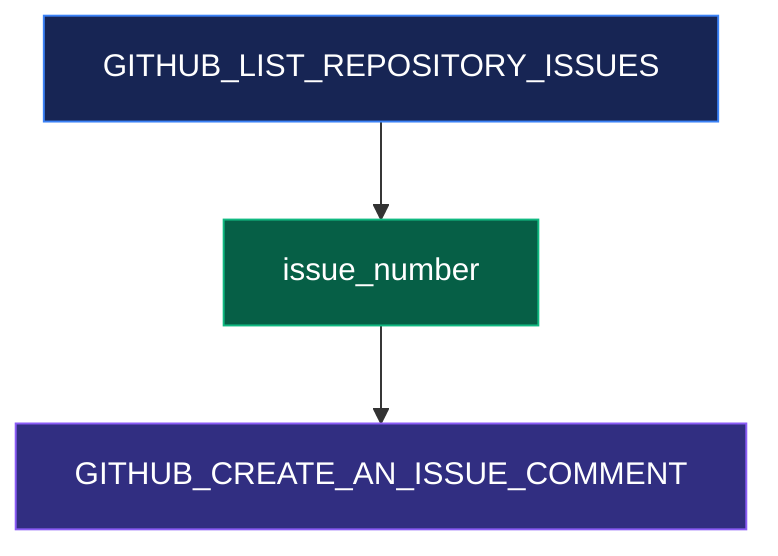
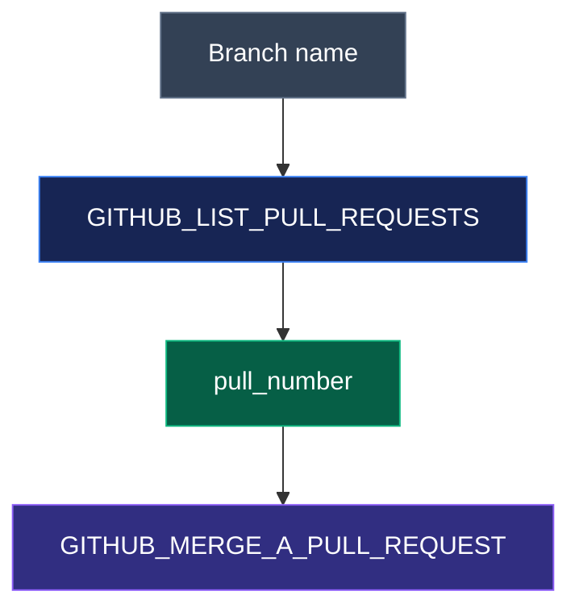
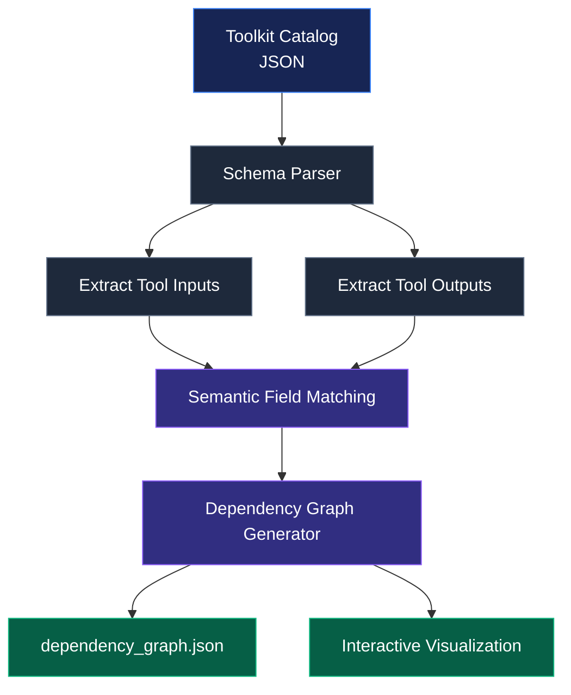

# ⚡ Universal Tool Graph Generator

<div align="center">


**A generic dependency graph engine that transforms toolkit catalogs into structured, interactive producer-consumer relationships.**

[](https://www.typescriptlang.org/)
[](https://nodejs.org/)
[](#)
[](#)

[Overview](#-overview) · [Architecture](#-how-it-works) · [Installation](#-installation) · [Usage](#-usage) · [Visualization](#-interactive-visualization)

</div>

---

## 🚀 Overview

AI agents need more than a collection of tools. They need to understand **which actions must happen before other actions can execute**.

The Universal Tool Graph Generator solves this problem by analyzing toolkit catalogs and automatically discovering dependencies between tools.

It identifies:

- What information a tool requires.
- Which other tools can produce that information.
- How one action can enable another action.
- Which dependencies should be represented as directed graph edges.

Instead of manually defining relationships, the generator reads a toolkit catalog and produces a structured dependency graph.

### ✨ Project Results

| Metric | Generated result |
|---|---:|
| Tools analyzed | 893 |
| Dependency relationships | 3,941 |
| Provenance ratio | 100% |
| Labeled edges | 3,941 |
| Example toolkit | GitHub |

*Results from the GitHub catalog used during development.*

---

## 🧠 Why This Project?

Imagine an AI agent needs to create a comment on a GitHub issue.

It needs an `issue_number`, but the user might not provide one directly.

The agent can first execute:

`GITHUB_LIST_REPOSITORY_ISSUES`

Then use the returned issue number to execute:

`GITHUB_CREATE_AN_ISSUE_COMMENT`

The generator discovers this relationship automatically.

### Example 1: Issue dependency



### Example 2: Pull request dependency

An agent has a branch name but needs a `pull_number` to merge a pull request.



---

## ⚙️ How It Works

The generator follows a simple pipeline:



### Dependency discovery process

1. **Catalog ingestion** — Read the supplied toolkit catalog from a command-line argument.
2. **Schema analysis** — Inspect tool input and output parameters.
3. **Nested schema traversal** — Follow references and nested objects to discover available fields.
4. **Semantic matching** — Normalize field names and identify compatible resource identifiers.
5. **Graph construction** — Create directed producer-to-consumer edges.
6. **Output generation** — Write the dependency graph as JSON and generate an HTML visualization.

---

## 🕸️ Graph Structure

The generated graph uses two primary components.

### Nodes

Each tool is represented by its Composio tool slug.

```json
{
  "id": "GITHUB_CREATE_AN_ISSUE_COMMENT",
  "service": "issues"
}
```

### Edges

Each edge represents a dependency between a producer and consumer.

```json
{
  "from": "GITHUB_LIST_REPOSITORY_ISSUES",
  "to": "GITHUB_CREATE_AN_ISSUE_COMMENT",
  "label": "issue_number"
}
```

### Output format

```json
{
  "nodes": [
    {
      "id": "GITHUB_LIST_REPOSITORY_ISSUES",
      "service": "issues"
    },
    {
      "id": "GITHUB_CREATE_AN_ISSUE_COMMENT",
      "service": "issues"
    }
  ],
  "edges": [
    {
      "from": "GITHUB_LIST_REPOSITORY_ISSUES",
      "to": "GITHUB_CREATE_AN_ISSUE_COMMENT",
      "label": "issue_number"
    }
  ]
}
```

---

## 🖥️ Interactive Visualization

The project generates an HTML-based graph visualization.

It allows you to explore tool relationships and inspect connected dependencies without rendering thousands of relationships in one oversized diagram.

**Visualization capabilities:**

- Interactive graph exploration.
- Search tools by slug.
- Inspect direct dependencies.
- Explore connected producer and consumer tools.
- Zoom and navigate the graph.

### Preview

Open `visualization.html` in your browser after generating the graph.

> The visualization is generated locally from the toolkit catalog. The HTML viewer uses the vis-network library.

---

## 🛠️ Tech Stack

| Technology | Purpose |
|---|---|
| TypeScript | Core generator implementation |
| Node.js | Runtime environment |
| JSON Schema | Tool input/output analysis |
| Composio Catalog | Toolkit metadata |
| vis-network | Interactive graph visualization |
| Mermaid | Documentation diagrams |
| npm | Dependency and script management |

---

## 📦 Installation

### Prerequisites

- Node.js
- npm
- Git

### Clone the repository

```bash
git clone https://github.com/YOUR_USERNAME/universal-tool-graph-generator.git

cd universal-tool-graph-generator
```

### Install dependencies

```bash
npm install --legacy-peer-deps
```

---

## ▶️ Usage

### Generate a dependency graph

Pass the toolkit catalog path as a command-line argument.

```bash
node --import tsx src/generate.ts path/to/catalog.json
```

Or use the npm script:

```bash
npm run generate -- path/to/catalog.json
```

### Example with GitHub

```bash
npm run generate -- github_catalog.json
```

### Generated files

```text
dependency_graph.json
visualization.html
```

### Run the self-check

```bash
npm run selfcheck
```

The self-check validates the generated graph structure and reports:

- Number of generated nodes.
- Number of dependency edges.
- Provenance ratio.
- Number of labeled edges.

---

## 📁 Project Structure

```text
universal-tool-graph-generator/
│
├── src/
│   ├── generate.ts
│   └── selfcheck.ts
│
├── github_catalog.json
├── dependency_graph.json
├── visualization.html
│
├── generator.json
├── package.json
├── package-lock.json
├── .gitignore
└── README.md
```

---

## 🎯 Design Goals

- **Toolkit agnostic:** Read different toolkit catalogs instead of relying on a hardcoded graph.
- **Schema driven:** Discover relationships from tool input and output schemas.
- **Semantic matching:** Match resource identifiers across producer and consumer actions.
- **Directed relationships:** Preserve producer-to-consumer dependency direction.
- **Traceable output:** Retain tool slugs and field labels in generated relationships.
- **Visual exploration:** Make complex tool dependencies easier to understand.

---

## 🔮 Future Improvements

- More advanced semantic matching using descriptions and parameter types.
- Confidence scores for discovered dependencies.
- Better disambiguation of identifiers shared by different resource types.
- Support for additional toolkit catalog formats.
- Dependency path exploration and workflow recommendations.
- AI-assisted dependency discovery.
- Graph filtering by service, resource type, and relationship.

---

## 🤝 Contributing

Contributions, suggestions, and improvements are welcome.

1. Fork the repository.
2. Create a feature branch.
3. Implement your changes.
4. Run the self-check.
5. Submit a pull request.

---

## 👨‍💻 Author

**Nanjundeshwara K**

Electronics & Communication Engineering | AI Engineer | Full Stack Developer | AI Agent Systems

GitHub: [@Nanjundi15](https://github.com/Nanjundi15)

---

<div align="center">

### ⚡ Turning tool catalogs into intelligent action graphs.

**Built for developers building the next generation of AI agents.**

⭐ If you find this project useful, consider giving it a star!

</div>
